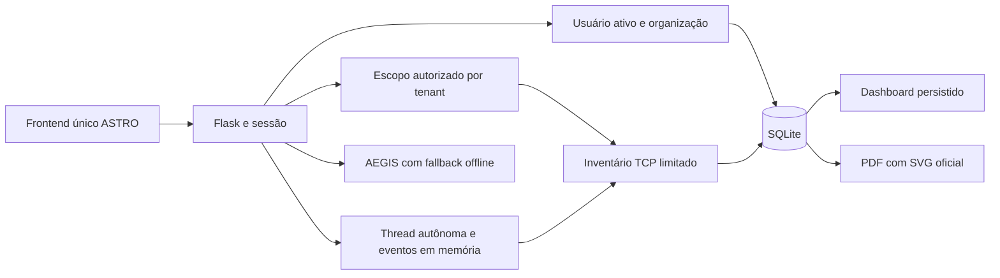

# ASTRO Cyber — arquitetura atual e evolução

Flask app factory + blueprints, SQLite stdlib e frontend HTML/CSS/JS servido pelo mesmo processo. Não há Next/TanStack em execução no produto. Código Go é preservado, mas não despachado pelo perfil defensivo atual. Dependências existentes preservadas; nenhuma instalada nesta sessão.

Preservado: autenticação, conta/plano, engagements/autorização, scanner manual, execução autônoma/polling, histórico, achados persistidos, relatórios autorizados, visão do gestor, revisão gerenciada, AEGIS e demo isolada no navegador. Isolamento anterior por account_id mantido e regressões executadas. Rotas públicas antigas e nomes internos não renomeados.

Novo `/api/dashboard`: autenticação ativa; organização derivada do banco, nunca do query param. Contagens de avaliações por status; achados da última execução concluída de cada string de alvo. Legados sem verification_status ficam não classificados. Não considera achados ausentes como corrigidos. Hosts com achados não equivalem ao inventário total. Alvos sobrepostos podem duplicar achados; limitação publicada.

Scanner: máximo de 64 candidatos gerados sem materializar CIDRs gigantes, 24 workers socket por host, timeout socket 1,5s e Nmap connect com host-timeout 30s/retry 1. Sem version probing intensivo, Go alternativo, payloads de exploração, tentativas de credenciais ou planejamento de ataque do autônomo. Eventos e execução ainda não são duráveis; zero achados não garante cobertura nem ausência de vulnerabilidades.

Próximas fronteiras: schema versionado de ativos/evidências/achados estáveis; migrations PostgreSQL após contratos e fixtures; fila persistida + worker isolado com orçamento global, cancelamento cooperativo, egress por escopo e recuperação após reinício. Evitar trocar banco/ORM sem testes de migração. Eventos precisam de sequência monotônica, e jobs de estados partial/skipped/error com cobertura estruturada.

AEGIS ainda aceita conteúdo de achado enviado pelo cliente em remediação: migrar para finding_id autorizado, fatos imutáveis, schema de resposta e hipóteses separadas. Nenhum comando do modelo deve ser executado automaticamente.

## Atualização 2026-10-11 — pacote de redesign

Integração detalhada e resultados em [REDESIGN.md](REDESIGN.md): navegação por URLs, avaliações com wizard/detalhe, API tenant-scoped, escopos com autorização owner e viewer somente leitura. Implementação por Codex. Claude executado pelo shell terminou exit 1 / ECONNREFUSED, sem alterações. 113 testes Python e contratos frontend passaram. QA visual continua pendente: Edge falhou por acesso negado e exibiu 0x80000003; não contornar proteções do ambiente. Scanner e dados reais preservados nesta etapa.

Arquitetura alvo e analise comparativa de web/conector/agente documentadas em PRODUCT_PLAN.md. Proposta incremental, nao implementada, pendente de revisao Claude PLAN-CLAUDE-01.
