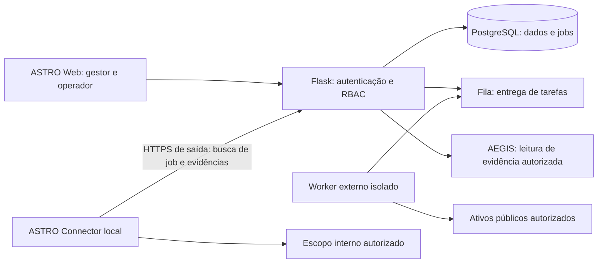

# ASTRO Cyber — plano de produto, arquitetura e UX

Data: 2026-10-11. Plano definido por Codex após pesquisa e ajustado pelo parecer concluído de Claude em CLAUDE_PRODUCT_PLAN_REVIEW.md. Decisões e primeiras correções em PRODUCT_PLAN_INTEGRATION.md. Este documento descreve evolução planejada, não funcionalidades entregues.

## 1. Decisão de produto

SaaS web de avaliação defensiva e acompanhamento de exposição, com conector local opcional por rede/ambiente. O cliente usa o navegador; a equipe de TI instala o conector quando precisa avaliar ativos internos. CLI é uma interface de instalação/diagnóstico/automação, não um produto concorrente. Não construir inicialmente um agente por endpoint, SIEM/EDR, SOC completo ou ferramenta de exploração autônoma.

Primeiro segmento: PME com equipe de TI pequena ou parceiro responsável, ativos definidos e interesse em acompanhamento de correções. Hipótese comercial a validar em entrevistas/pilotos: evidência compreensível, ação de correção e revalidação trazem mais valor recorrente que uma contagem de vulnerabilidades. Não há validação de demanda ou promessa de cobertura universal.

## 2. Pesquisa comparativa

| Referência oficial | Padrão observado | Aplicação ASTRO / limite |
| --- | --- | --- |
| [Tenable Agents](https://docs.tenable.com/vulnerability-management/Content/Settings/Sensors/Agents.htm) | Sensores por endpoint, processamento local e comunicação HTTPS de saída; redes distinguem IPs sobrepostos | Planejar segregação por organização/rede e saída HTTPS. Agente endpoint fica posterior; não confundir com scanner de rede. |
| [NodeZero Runner](https://docs.horizon3ai.com/portal/runner/) | Portal e runner na rede interna; execução externa em infraestrutura do fornecedor | Referência para separar controle e execução. ASTRO mantém apenas avaliações defensivas limitadas, sem reproduzir exploração intrusiva. |
| [Greenbone architecture](https://docs.greenbone.net/GSM-Manual/gos-24.10/en/architecture.html) | Interface/gerenciador e scanner separados | Extrair scanner do processo HTTP e persistir orquestração. Não importar stack completa ou feeds sem avaliação técnica/licenciamento. |
| [Wazuh architecture](https://documentation.wazuh.com/current/getting-started/architecture.html) | Agentes em endpoints e componentes centrais servidor/indexador/dashboard | Mostra que telemetria contínua de endpoint exige outra arquitetura/custos. Não apresentar scanner TCP como SIEM ou EDR. |
| [Tenable roles](https://docs.tenable.com/vulnerability-management/Content/Settings/access-control/TenableRolePrivileges.htm) | Privilégios por função de usuário | Papéis e capacidades definidos no backend; esconder botão não é autorização. |

Estas observações apoiam a recomendação híbrida; a escolha é inferência de projeto para ASTRO, não recomendação dos fornecedores. Não alegar vantagem exclusiva ou equivalência funcional com essas plataformas.

## 3. Como o cliente usará

1. Gestor cria organização e indica responsável técnico.
2. Responsável cadastra ambientes e escopos; pessoa autorizada aprova escopo, validade e perfil permitido.
3. Para rede interna, instala ASTRO Connector em uma máquina/VM com alcance ao segmento escolhido; valida conexão antes da primeira avaliação.
4. Operador inicia uma avaliação pelo navegador. SaaS registra job; conector autorizado busca somente jobs da sua organização/rede e revalida limites locais.
5. Evidências e cobertura retornam ao SaaS; analista distingue observação/suspeita/confirmação.
6. Equipe acompanha ações; nova avaliação direcionada permite revalidação. Ausência de resultado só vira correção confirmada quando o método cobre efetivamente a verificação anterior.
7. Gestor vê resumo e evolução explicável; operador pode abrir as mesmas evidências técnicas.

Para ativos públicos, worker externo isolado pode dispensar conector depois de prova de controle/autorização e proteção de egress. Não usar o Flask público para alcançar redes privadas ou metadados cloud. Browser não realiza varredura TCP arbitrária; o scanner atual alcança a rede da máquina onde o backend roda, não automaticamente a rede do cliente remoto.

### Alternativas avaliadas

| Modelo | Vantagem | Custo/limitação | Decisão |
| --- | --- | --- | --- |
| Web + scanner central | Instalação simples para ativos públicos | Não enxerga LAN atrás de NAT; egress e isolamento exigem proteção | Parte do híbrido, posterior ao hardening |
| CLI somente | Útil em laboratório/automação | Gestão, colaboração e relatórios ficam fragmentados | Interface complementar |
| Conector por ambiente | Acesso controlado à LAN, sem instalar em todos os hosts | Instalação, atualização e conectividade por segmento | Próximo protótipo após jobs duráveis |
| Agente por endpoint | Visibilidade local de pacotes/patches/configurações | Privilégios, multiplataforma, atualização, suporte e coleta sensível | Posterior, motivado por necessidade comprovada |
| Plataforma inteira on-prem | Atende algumas restrições de dados | Duplicação de operação, upgrade, backup e suporte | Somente depois de demanda comercial |

## 4. Arquitetura alvo incremental

Desenho alvo; hoje há Flask+SQLite, execução por threads e eventos voláteis. Preservar Flask e core defensivo. Decisão após revisão Claude: começar com migrações versionadas e tabela de jobs com leases no SQLite, sem adicionar Redis/Celery. Worker interno primeiro, usando o mesmo protocolo de tarefas/eventos/evidências que depois servirá ao conector remoto. Retry exige tratamento de duplicação, cancelamento e tentativas expiradas; lease não garante execução exatamente uma vez. Validar atomicidade, limites operacionais e contenção. PostgreSQL entra antes de expansão comercial/múltiplos workers conforme resultados dos testes, com backup/restauração e migração verificadas. Fila externa só se necessidade medida justificar; banco permanece fonte durável.

Conector v0: Linux em VM ou container com conectividade explicitamente testada, reutilizando Python/core após separar dependências Flask. Serviço executa com menor privilégio possível. Docker é distribuição opcional, não requisito de produto; rede do container/VLANs influenciam alcance. Windows, MSI, atualizações automáticas e privilégios elevados entram após piloto.

Requisitos mínimos antes de distribuição:

- Identidade exclusiva do conector vinculada no servidor à organização e network_id; não confiar em account_id enviado no payload.
- Enrollment de uso único e expiração curta, tokens próprios revogáveis/rotacionáveis, segredo protegido localmente; considerar mTLS após avaliação operacional.
- Somente HTTPS iniciado pelo conector, validação de certificado, suporte documentado a proxy; nenhuma porta de gerenciamento aberta na LAN.
- Jobs estruturados por perfil versionado; nunca shell arbitrário, plugins enviados pelo usuário ou instruções executáveis de AEGIS.
- Escopo autorizado versionado, data de validade, exclusões, bloqueios e limites de hosts/portas/tempo/CPU/concurrency. Checagem no servidor e conector, inclusive resolução DNS/IPv6.
- job_id, attempt_id, lease, expiração e deduplicação; retries não podem repetir operação indiscriminadamente.
- Eventos monotônicos, upload limitado por tamanho, sanitização/mascaramento de segredos e retenção definida. Evidência íntegra com proveniência; hash sozinho não prova veracidade.
- Heartbeat/offline, buffer local limitado, retomada, cancelamento cooperativo e limites locais que continuam válidos se perder a conexão.
- Atualização com assinatura e rollback; instalação/revogação/desinstalação testadas. Perda/comprometimento de conector deve permitir revogação imediata.
- Redes privadas permitidas apenas pelo escopo interno; bloqueios de loopback/link-local/cloud metadata e infraestrutura de controle conforme política. Não bloquear indiscriminadamente RFC1918 no conector interno.

## 5. Telas por função e por tarefa

Um frontend/design system e navegação consistente. Mudam conteúdo inicial, densidade e ações segundo capacidade. Um usuário com capacidades técnicas pode alternar resumo executivo/técnico; alternar apresentação nunca concede permissão. As rotas compartilhadas mantêm contexto/organização e autorização no backend.

| Perfil | Página inicial e foco | Ações | Limite |
| --- | --- | --- | --- |
| Gestor / owner | Resumo executivo: exposição conhecida, cobertura, prioridades e evolução verificada | Autorizar escopo, acompanhar equipe/relatórios | Papel atual não inicia scan; futura capacidade de operador requer concessão explícita |
| Operador | Visão operacional: execuções, falhas, cobertura e próximos trabalhos | Iniciar avaliações autorizadas, investigar evidências e propor correções | Não autoriza escopo nem acessa outra empresa |
| Viewer | Resumo e relatórios de leitura | Consultar e exportar conforme permissão | Sem cadastro/autorizações/execuções |
| Administrador da organização | Acesso, conectores, política e auditoria | Gerenciar membros/capacidades e revogar conector | Novo modelo de capacidades; não confundir com admin ASTRO existente |
| Equipe ASTRO / suporte | Área operacional própria, provisionamento e saúde | Suporte com acesso explícito, temporário e auditado | Não conceder acesso transversal automático; backoffice ainda planejado |

Página funcional ≠ repetir dashboard:

| Área | Composição planejada |
| --- | --- |
| Visão executiva | Poucas métricas reais, prioridades com motivo, período/fonte/cobertura; links para dados de origem |
| Avaliações | Tabela de execuções com filtros na URL, status, perfil, origem/conector e cobertura |
| Scanner / detalhe | Abas, console mono, timeline, falhas/parcial, evidências e inspector; console não ocupa visão executiva |
| Ativos | Lista por ambiente/responsável/criticidade; detalhe com serviços e histórico. Só após modelo estável de ativo |
| Achados | Fila de trabalho, confirmação e severidade separadas, evidência, responsável e ações; detalhe rastreável |
| Correções | Estados de trabalho, tarefa e revalidação; não usar ausência de achado como encerramento automático |
| Relatórios | Preview editorial executivo/técnico, escopo/metodologia/limitações e exportação; fonte e versão |
| Conectores | Saúde real, última comunicação, ambiente/versão, instalação e revogação; não exibir conector fictício |
| Configurações | Organização, membros/permissões, políticas, retenção e integrações; assinatura SaaS separada |
| AEGIS | Painel contextual da avaliação/achado; respostas com referências e fatos/hipóteses/sugestões diferenciados |

## 6. Design/layout: aplicação das referências

Manter #0A0A0A, escala oficial, Instrument Sans, SVGs existentes, temas claro/escuro e cantos 14/16/20. Cor semântica sinaliza estado real; severidade e confirmação usam etiquetas distintas. Não produzir score financeiro ou indicador 'seguro' sem metodologia e cobertura.

- Shell estável e breadcrumb; títulos por objeto/tarefa e ação principal pertinente. [Carbon UI shell](https://v10.carbondesignsystem.com/components/UI-shell-left-panel/usage/) apoia navegação lateral frequente; ASTRO adapta a marca, não importa aparência IBM.
- Tabelas para investigar dados; toolbar com busca/filtros, detalhe progressivo e ações por linha. [Carbon data table](https://www.carbondesignsystem.com/building-blocks/core/components/data-table/guidelines) orienta toolbar, expansões e seleção; só implementar bulk actions que a API suporte.
- Resumo → avaliação → achado → evidência, preservando filtros ao voltar. [Grafana best practices](https://grafana.com/docs/grafana/latest/visualizations/dashboards/build-dashboards/best-practices/) orienta hierarquia de dashboards e aprofundamento. Adaptar isso à segurança com entidades reais.
- Evitar a mesma grade de cards em todas as páginas. Console é operacional, relatório é editorial, configuração é formulário e lista de políticas.
- Carregamento, vazio, erro, parcial, sem permissão, offline e dados desatualizados têm apresentações específicas. Polling não deve mover foco ou trocar toda a página.
- Mobile permite consultar e aprovar com controles claros; console/tabelas densas têm rolagem local e coluna prioritária. Nenhuma ação relevante disponível só no hover.
- Alvo: [WCAG 2.2 AA](https://www.w3.org/TR/WCAG22/), incluindo teclado, foco visível/não encoberto, nome acessível, contraste de texto e mensagens de estado. Testar contraste oficial, zoom 200%, leitores e 320–1920px; conformidade ainda não certificada.

## 7. Roadmap e critérios de conclusão

| Etapa / dono proposto | Entrega | Valor / esforço / risco | Gate para seguir |
| --- | --- | --- | --- |
| S0 — Claude revisa, Codex integra | Helpers scoped explícitos, revisão managed/assignments, capacidades sem bypass admin, proteção de sessão/CSRF e regressões | Alto / médio / alto | Testes multiempresa, permissions e dados sem tenant |
| S1 — Claude backend; Codex contrato/UI | Migrações SQLite, jobs com leases, worker interno, eventos/cobertura persistidos, timeout/cancelamento/recuperação | Alto / alto / alto | Reinício/retry/duplicação e quota atômica testados |
| S2 — Claude dados; Codex páginas | network_id, ativos/serviços/achados estáveis, migrações PostgreSQL | Alto / alto / alto | Mesmo IP em redes diferentes; migração/restauração; evidência referenciada |
| S3 — Codex UX; Claude API/RBAC | Visões executivo/operador, filas de correção, relatórios e AEGIS contextual | Alto / médio / médio-alto | Fluxos reais por perfil e referência de cada recomendação |
| S4 — Claude conector; Codex onboarding/status | Enrollment, heartbeat, um perfil TCP defensivo, job/upload/revogação em laboratório | Alto / alto / alto | Sem shell arbitrário; tenant/escopo local; egress/offline/replay/cancelamento |
| S5 — ambos | Piloto controlado, observabilidade, backup, limites e suporte | Alto / médio-alto / alto | Operação e recuperação comprovadas; autorização escrita e capacidade de suporte |

Não fixar prazo/calendário sem estimar S1/S2 e disponibilidade. Agendamento, alertas e revalidação entram quando jobs/cobertura sustentarem resultado confiável. Agente endpoint só após demanda e orçamento de suporte multiplataforma. Diferenciais iniciais: explicação acessível em português, evidência transparente, continuidade da correção e revalidação comprovada; validar com clientes.

## 8. Divisão imediata e coordenação

Codex: pesquisa/documento, mapa de telas/capacidades, contratos UX, integração/testes. Arquivos sob sua responsabilidade: PRODUCT_PLAN.md, TASKS.md e futuramente frontend.

Claude tarefa PLAN-CLAUDE-01: revisar arquitetura híbrida contra backend real e produzir ONLY docs/agents/CLAUDE_PRODUCT_PLAN_REVIEW.md. Deve propor schema/API/job state machine, threat model enrollment/egress/retries, dependências de migração e tarefas backend por arquivo, sem editar código atual. Não executar scans, instalar dependências, ler credenciais, acessar sites externos, commitar ou dar push. Fontes já pesquisadas constam neste documento. Critérios: distinguir existente/proposto, testar suposições por leitura do código, registrar objeções e gate de cada sprint. Codex não edita esse novo documento durante execução.

Método confirmado: script CLAUDE_REVIEW_LOCAL.ps1 -Task product-plan no terminal normal do usuário. Parecer concluído; gravação Write foi negada pelo Claude, então Codex salvou o texto do resultado JSON sem contornar permissões. Codex integrou as decisões e corrigiu o vazamento nas rotas de revisão. Implementação completa S0/S1, conector e novas telas permanecem pendentes. Tarefas futuras precisam de arquivo exclusivo por agente e integração/testes antes de aprovação.
