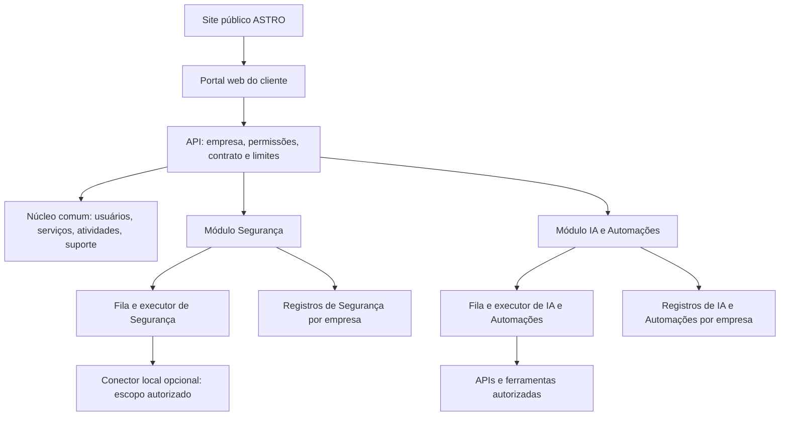

# ASTRO — nova direção, plataforma modular e prompt de design

Versão 1.1 · 13/10/2026 · Planejamento para três estudantes com conhecimentos em cibersegurança e IA.

**Regra visual obrigatória, confirmada pelo trio:** preservar o design preto e branco da plataforma atual. Mudar o layout, a organização e os percursos para acomodar os serviços. Não criar uma nova identidade visual ou paleta.

**Objetivo deste arquivo:** explicar a mudança de ideia a uma IA, escolher o formato da plataforma e fornecer instruções completas para começar pelo design. A implementação da lógica fica para uma etapa posterior. Este documento registra uma nova direção; não afirma que as funcionalidades já existem.

## 1. A decisão em linguagem simples

**A ASTRO será uma empresa de tecnologia desde o início, com um site de apresentação e uma aplicação web única para os clientes.** Cada empresa verá os serviços que contratou. A estrutura permitirá adicionar novos serviços sem criar outro cadastro, outro painel e outro sistema de atendimento toda vez.

O cliente acessará pelo navegador, como acessa um sistema de gestão. Não precisará usar terminal. Um programa instalado poderá ser acrescentado quando uma tarefa precisar acessar a rede ou o computador dele. Esse programa será um componente de execução, enquanto o painel continuará na web.

Exemplo: a Empresa A contrata Segurança e vê seus ativos e pendências. A Empresa B contrata IA e Automações e vê seu assistente, rotinas e resultados. A Empresa C contrata os dois e encontra ambos no mesmo painel. Nenhuma delas pode acessar dados das outras.

**O que vocês definiram:** tecnologia como foco amplo, conhecimentos em ciber e IA, possibilidade de duas ofertas iniciais, expansão futura e design antes da lógica. **Proposta deste documento:** organizar as duas linhas como **ASTRO Segurança** e **ASTRO IA e Automações**. Os pacotes comerciais exatos ainda precisam ser definidos. Automação pode usar regras comuns; nem toda automação precisa de IA. A classificação pode ser ajustada sem mudar a estrutura principal.

“Preparada para expansão” significa ter cadastro de serviços, permissões e componentes reutilizáveis. Não significa construir agora todos os serviços que a empresa talvez ofereça.

## 2. O que mudou em relação à ideia anterior

| Antes | Nova direção | Efeito no design |
|---|---|---|
| ASTRO centrada no scanner de segurança | ASTRO como empresa de tecnologia com serviços modulares | Marca principal ampla; Segurança e IA/Automações têm áreas próprias |
| Scanner tratado como centro de toda a aplicação | Scanner como ferramenta dentro de Segurança | Tela inicial mostra o trabalho do cliente, não somente scans |
| Planos amplos com capacidades ainda incompletas | Ofertas delimitadas, com ativação por empresa e escopo contratado | Mostrar serviço, situação, limites e próximos passos |
| IA principalmente para explicar resultados de segurança | IA também como serviço próprio, com dados e tarefas autorizados | Assistente e rotinas com fontes, aprovação e histórico |
| Ampliação apenas depois de uma primeira oferta | Duas linhas previstas desde a primeira versão | Projetar as duas; desenvolver percursos pequenos que o trio consiga manter |
| Expansão por adicionar telas soltas | Novo serviço ligado a um núcleo comum | Mesmo padrão de navegação, usuários, relatórios, suporte e acesso |

Esta direção substitui, para o novo design, a recomendação anterior de apresentar apenas uma linha inicialmente. A crítica técnica do scanner permanece válida: ampliar a marca não torna o código um pentest completo nem confirma demanda.

O guia para começar do zero continua útil para aprendizado e organização. Aqui adotamos a informação mais recente: vocês têm conhecimentos em ciber e IA. Isso permite projetar duas linhas, mas não implica especialização em todas as áreas, capacidade 24h ou produto pronto.

## 3. Pesquisa de plataformas: o que aproveitar e o que evitar

Foram consultadas referências oficiais de automação, IA, segurança, gestão de acesso e aplicações instaláveis em 13/10/2026. A seleção cobre padrões representativos; não é uma lista de todas as plataformas existentes. Não houve teste contratado dessas ferramentas ou medição comparativa de desempenho. As críticas abaixo são **avaliações de adequação à ASTRO**, e não afirmações de defeitos comprovados nos fornecedores.

| Referência e fato documentado | O que aproveitar | Limite ou dificuldade para a ASTRO |
|---|---|---|
| [n8n — execuções](https://docs.n8n.io/build/understand-workflows/understand-executions.md): separa testes manuais, produção e histórico | Mostrar cada execução, seu estado e a versão usada | Editor completo de fluxos amplia muito o escopo; o cliente inicial pode precisar só de configuração guiada |
| [Make — execuções incompletas](https://help.make.com/incomplete-executions): permite guardar e tratar execuções que falharam; recurso desativado por padrão | Área de falhas, explicação e caminho de recuperação | Tentativas podem repetir efeitos; na ASTRO, “tentar novamente” precisa de regra e confirmação quando houver impacto |
| [Zapier — conexões compartilhadas](https://help.zapier.com/hc/en-us/articles/8496326497037-Share-app-connections-with-members-of-your-Team-or-Enterprise-account): distingue conexão privada/compartilhada e efeitos da revogação | Conexões com proprietário, escopo, acesso e situação visíveis | Compartilhar uma conexão concede poder sobre a conta ligada; evitar “compartilhar com todos” por padrão |
| [Power Automate — cloud e desktop](https://learn.microsoft.com/power-automate/desktop-flows/trigger-desktop-flows): fluxos na nuvem podem acionar execução em máquina registrada | Separar painel de controle e execução local | Máquina, conexão e licença são dependências reais; não sugerir que navegador sozinho executa qualquer tarefa no PC |
| [Power Platform — políticas de dados](https://learn.microsoft.com/en-us/power-platform/admin/wp-data-loss-prevention): controla combinações e uso de conectores | Tornar acessos e restrições compreensíveis na interface | Governança pode suspender operações; uma tela precisa explicar bloqueio e correção, não só exibir erro técnico |
| [UiPath — Orchestrator](https://docs.uipath.com/orchestrator/automation-cloud/latest/user-guide/introduction): painel web gerencia execução, filas e logs | Histórico e distinção entre uma rotina e uma tentativa de executá-la | Infraestrutura e privilégios de robôs são complexos para o primeiro produto; adiar automação visual ampla do desktop |
| [Dify — documentação](https://docs.dify.ai/en/home): aplicações de IA, conhecimento, publicação web e APIs | Separar fontes de informação, configuração do assistente e uso pelo cliente | Fluxos e bases precisam de limites e teste; uma conversa bonita não demonstra precisão ou segurança |
| [Langfuse — acesso](https://langfuse.com/docs/administration/rbac): organiza usuários, organizações e projetos; granularidade varia por edição/plano | Contexto da empresa sempre visível, perfis e histórico por projeto | Observabilidade técnica é extensa; mostrar ao cliente tarefas/resultados e guardar detalhes para operadores |
| [Wazuh — componentes](https://documentation.wazuh.com/current/getting-started/components/index.html): agentes e componentes centrais, incluindo dashboard | Interface central com execução/coleta local quando necessária | Operação de agentes e armazenamento exige manutenção; não transformar o ASTRO em um SIEM completo nesta fase |
| [DefectDojo — dashboard](https://docs.defectdojo.com/metrics_reports/dashboards/introduction_dashboard/): apresenta achados e acompanhamento; documentação distingue versões | Dar acesso ao detalhe a partir de resumo e acompanhar pendências | Contagem/severidade não prova probabilidade de perda; evitar um “índice de segurança” inventado |
| [DefectDojo — permissões](https://docs.defectdojo.com/admin/user_management/about_perms_and_roles/): modelo descrito de membros/grupos é da edição Pro; open source tem outro modelo | Separar acesso a dados e administração da plataforma | Não pressupor que toda função documentada esteja disponível gratuitamente |

**Síntese de design:** aproveitar catálogo de aplicações, contexto por empresa, histórico de execução, conexões autorizadas, recuperação de falhas e acompanhamento de pendências. Simplificar a experiência do cliente; preservar detalhes técnicos para quem opera o serviço. Não copiar a aparência, marca ou telas dos fornecedores.

### Licenças e incorporação de ferramentas

- [FAQ oficial do n8n](https://support.n8n.io/article/can-i-use-your-license-for-my-use-case), atualizado em 06/10/2026: diferencia entregar resultados de fluxos operados pela sua organização de permitir que clientes construam/configurem fluxos, inclusive por interface própria ou API. Também trata hospedagem como serviço e marca branca. O uso concreto deve ser confrontado com os termos; um editor visual próprio sobre n8n não elimina a questão de licença.
- [Licença do Dify](https://github.com/langgenius/dify/blob/main/LICENSE): contém condições adicionais para operação multiempresa por workspaces e para uso de sua interface/marca. Não presumir que remover o logo e hospedar para vários clientes seja permitido.
- A primeira versão do design deve ser independente do fornecedor. O motor de execução será decidido depois. Os fornecedores da pesquisa são referências de funcionamento, não dependências aprovadas ou parcerias da ASTRO.
- A documentação de [direitos de acesso a recursos da Stripe](https://docs.stripe.com/billing/entitlements) é referência para relacionar compra e recurso disponível. A ASTRO não precisa escolher Stripe agora; precisa distinguir contrato, acesso, permissão e limite de uso.

## 4. Web, `.exe`, terminal ou várias plataformas?

| Formato | Vantagem | Custo/limite | Decisão proposta |
|---|---|---|---|
| Site público | Apresenta a empresa e os serviços; não exige conta | Não executa sozinho o serviço contratado | Construir a vitrine |
| Aplicação web com login | Mesmo acesso para relatórios, IA, rotinas e equipe; atualização central | Depende de internet e operação do servidor; rede local não fica automaticamente acessível | Interface principal |
| Aplicativo instalado com interface própria | Pode acessar recursos locais conforme autorização | Instalador, atualização, sistemas operacionais e suporte adicionais | Adiar até existir necessidade que o navegador não resolve |
| Conector local com pequena tela de estado | Executa/coleta apenas tarefas locais autorizadas e envia resultados ao portal | Precisa de pareamento, atualização, revogação e escopo restrito | Prever no design; implementar quando necessário |
| Terminal/CLI | Útil para instalação técnica, diagnóstico e integrações | Pouco adequado ao cliente não técnico | Ferramenta interna/opcional |
| Plataformas separadas por serviço | Permite ciclos muito diferentes e isolamento de instalações | Repete usuários, navegação, suporte e acesso | Não é a primeira escolha; manter separação técnica onde houver risco |

Um `.exe` é um arquivo executável do Windows. Ele pode abrir uma janela ou rodar em segundo plano; não precisa funcionar num terminal. Empacotar uma página web num aplicativo instalado não dá, por si só, autorização ou capacidade para acessar toda a rede.

Se uma versão desktop com janela vier a ser justificada, frameworks como Tauri são opções a avaliar. A [documentação de distribuição Windows do Tauri](https://v2.tauri.app/distribute/windows-installer/) mostra que existe trabalho específico de instalador e dependências. Não escolher framework desktop apenas para a ASTRO “parecer um produto”.

**Resposta recomendada:** site + portal web modular. Conector local opcional para tarefas que dependam do ambiente do cliente. Uma experiência para o cliente; mecanismos de execução separados e autorizados por serviço.

### O formato depende da tarefa contratada

| Tarefa | Onde o cliente usa | Onde o trabalho acontece | Precisa instalar? |
|---|---|---|---|
| Consultar resultados, pendências e relatórios de Segurança | Portal web | Servidor e dados importados | Não |
| Coletar informações da rede interna autorizada | Portal web para solicitar e acompanhar | Conector no ambiente autorizado | Pode precisar; importação de resultados é alternativa inicial |
| Conversar com assistente e consultar fontes autorizadas | Portal web | Servidor e provedor de IA aprovado | Não, na proposta inicial |
| Automatizar sistemas que oferecem APIs acessíveis | Portal web | Executor no servidor e APIs autorizadas | Geralmente não; conectividade privada pode exigir componente local |
| Automatizar programa instalado ou recurso só acessível no cliente | Portal web para configurar e acompanhar | Executor local adequado à tarefa | Pode precisar; automação de tela não está incluída automaticamente no conector de Segurança |
| Instalação e diagnóstico técnicos | Tela auxiliar ou terminal do técnico | Ambiente correspondente | Conforme componente; não exigir comandos do usuário comum |

O serviço pode ser contratado sem precisar de `.exe`. Quando a execução local for necessária, o instalador deve habilitar somente as capacidades autorizadas. Ele não libera serviços pagos e não recebe acesso irrestrito ao computador. Uma eventual interface desktop completa será uma decisão futura, condicionada à necessidade; o portal web é o formato principal definido para o design.

## 5. O que são os dois serviços iniciais

São **linhas de serviço propostas para organizar o design**. Dentro de cada linha, a primeira entrega será pequena. Um pacote comercial poderá contratar apenas algumas capacidades; a interface não deve prometer tudo o que está nesta visão de expansão.

### 5.1 ASTRO Segurança

**Problema proposto:** a empresa precisa entender o que foi observado, decidir quem vai agir e acompanhar a correção com evidência.

Primeiro percurso: cadastrar um ambiente autorizado → importar dados de uma fonte acordada → revisar observações/achados → criar pendências → anexar evidência → revalidar → gerar relatório.

Telas de design: visão geral, ambientes/ativos, avaliações, detalhe de achado, pendências e relatório. Ativo significa computador, sistema ou recurso acompanhado. Achado significa um resultado que merece análise; não é automaticamente uma falha confirmada.

O scanner anterior entra como uma fonte limitada de inventário. A revisão do ZIP identificou observações de portas TCP; não sustenta a promessa de pentest autônomo completo. A versão inicial pode importar dados antes de ter um conector de rede próprio.

No design, separar: **observação**, **suspeita**, **confirmado** e **não verificado**. Mostrar origem, data, escopo e evidência. “Nenhum problema encontrado” não significa “empresa protegida”. Se nenhuma avaliação foi feita, mostrar “Ainda não avaliado”.

Fora da primeira oferta: resposta automática a incidentes, exploração ofensiva ampla, garantia de ausência de vulnerabilidades e monitoramento humano 24h. Conhecimento em ciber ajuda a desenvolver; as promessas dependem de capacidade comprovada e escopo contratado.

### 5.2 ASTRO IA e Automações

**Problema proposto:** uma equipe precisa consultar informações aprovadas e reduzir tarefas repetitivas, mantendo controle sobre o resultado.

Primeiro percurso de IA: adicionar material autorizado → verificar que está pronto para uso → fazer uma pergunta → receber resposta com referências → aceitar, editar ou rejeitar um rascunho. Se não houver material suficiente, informar isso e pedir esclarecimento.

Primeiro percurso de automação: escolher uma rotina preparada pelo trio → conectar os sistemas permitidos → definir campos e limites → testar com dados fictícios → revisar → ativar → acompanhar execuções e exceções.

Para o protótipo, usar um exemplo: pedido recebido → classificação sugerida → aprovação humana → tarefa registrada. O cliente pode contratar o assistente, a rotina ou ambos, conforme o pacote. IA não deve comandar scanner, executar scripts ou alterar dados de outro serviço por estar dentro do mesmo portal.

Telas: assistente, fontes, rotinas, execução, aprovações, conexões e consumo. Não iniciar com um editor universal de arrastar centenas de componentes. Preferir formulários claros para configurar um modelo de rotina aprovado. A interface de configuração não determina qual ferramenta poderá ser incorporada legalmente depois.

Fora da primeira entrega: agente universal, acesso automático a todos os documentos da empresa, integração com qualquer sistema, decisões financeiras autônomas e uso ilimitado.

## 6. Uma plataforma, serviços liberados conforme o contrato

Há quatro perguntas diferentes para permitir uma ação:

1. **O serviço está contratado e ativo para esta empresa?** Exemplo: Segurança está ativa; IA ainda não foi contratada.
2. **Esta pessoa tem permissão?** Uma pessoa pode ler relatório e não executar avaliação.
3. **A ação está dentro do escopo autorizado?** Um ambiente ou fonte pode estar autorizado, outro não.
4. **Há limite e condição operacional disponíveis?** Consumo pode estar esgotado, conexão expirada ou rotina pausada.

Esconder um botão responde apenas à apresentação visual. Na etapa de lógica, o servidor e o executor também precisarão validar essas regras. Alterar a URL, o JavaScript ou uma configuração local não pode liberar recurso.

| Situação | O que o cliente vê | Comportamento planejado |
|---|---|---|
| Serviço ainda não contratado | No catálogo: explicação e “Conversar sobre este serviço” | Não permite executar; não exibe dados reais de outro cliente |
| Contratado, em configuração | Lista do que falta e contato responsável | Só permite as ações compatíveis com configuração |
| Ativo | Entradas do serviço no menu e seus resultados | Ações conforme perfil, escopo e consumo |
| Pessoa sem permissão | Explicação objetiva e contato do administrador | Ação bloqueada; não confundir com necessidade de comprar plano |
| Limite atingido | Qual limite, período e opções de ajuste | Nova execução bloqueada ou tratada conforme contrato; sem cobrança surpresa |
| Serviço suspenso/cancelado | Situação, efeito sobre execuções e acesso aos registros | Política de consulta/exportação/retenção definida; cancelamento não apaga tudo automaticamente |
| Serviço futuro | No máximo indicação “Em planejamento”, se útil | Sem botão de comprar, preço ou promessa de data |

Para demonstração, “ativar serviço” significa alternar um cenário de dados fictícios. Em produção, a ativação terá origem controlada: contrato confirmado e registro administrativo ou processo de cobrança verificado. O operador interno também não pode ignorar limites por conveniência.

Um sinalizador de funcionalidade, usado para lançar um recurso gradualmente, é diferente de serviço contratado. Ambos podem restringir acesso; nenhum deve conceder acesso além da permissão do usuário.

## 7. Estrutura técnica para crescer sem recomeçar tudo

Explicação simples: o **portal** mostra informações; a **API** recebe pedidos e verifica acesso; os **executores** fazem o trabalho; o **banco** guarda registros. Credenciais e arquivos são armazenados com controles próprios. O site público apresenta a empresa e encaminha ao portal.



É um desenho conceitual. Não afirma que essas conexões já foram implementadas nem obriga a ter um servidor por caixa do desenho.

### Núcleo comum desde a primeira versão

- Empresas, usuários, membros e permissões.
- Catálogo de serviços e capacidades contratadas.
- Atividade, notificações, aprovação e atendimento.
- Consumo/limites e situação do contrato.
- Padrão de relatórios, arquivos e eventos de auditoria.

### Organização dos módulos

Começar com um backend organizado em módulos dentro do mesmo projeto, preservando as partes úteis da base atual se forem escolhidas após revisão. Esse formato é conhecido como **monólito modular**: um projeto com divisões claras. Evita manter vários sistemas de negócio desde o início. Processos de execução com riscos diferentes podem ficar separados mesmo que compartilhem o repositório.

Não decidir agora por Kubernetes, dezenas de microsserviços ou uma loja que execute plugins de terceiros. Modularidade inicial pode ser um cadastro controlado e interfaces internas claras. Não precisa de mecanismo genérico que rode código enviado pelo cliente.

O ZIP anterior usava Flask. Aproveitá-lo é uma opção, não autorização para mexer em produção ou necessidade de reproduzir toda a interface legada. Antes da lógica, identificar o repositório real e o framework da aplicação escolhida. Não migrar frontend/backend só por preferência da IA de design.

### Informações mínimas previstas

| Registro | Para que serve |
|---|---|
| Empresa e membro | Determinar de quem são os dados e quem pode acessá-los |
| Serviço e capacidades | Descrever uma oferta e os recursos que ela pode habilitar |
| Contratação | Registrar empresa, escopo, situação, vigência e limites |
| Conexão | Referenciar uma conta/sistema autorizado; guardar segredo fora da interface |
| Execução | Registrar pedido, versão, estado, consumo e resultado |
| Aprovação | Registrar quem autorizou qual ação, com qual conteúdo |
| Relatório/arquivo | Rastrear origem, acesso e data, sem misturar empresas |
| Evento de auditoria | Registrar alterações de acesso, serviço, configuração e ação |

Segurança terá seus próprios ativos, avaliações e achados. IA terá fontes, assistentes e resultados. Não obrigar tudo a caber numa tabela genérica sem estrutura.

### Contrato de extensão de um novo módulo

Cada novo serviço deve declarar um identificador estável, nome, versão, rotas, itens de menu, permissões, capacidades, limites, tipos de execução e relatórios. Deve especificar dados necessários, política de retenção, suporte e custo de operação. O núcleo lê essas definições; não precisa ser refeito para cada nova oferta.

No design, simular a entrada de um terceiro módulo chamado “Novo serviço demonstrativo”. Ele aparece no catálogo como não disponível e prova o encaixe de layout, sem anunciar um serviço comercial existente.

### Limites que precisam orientar a lógica futura

Consulta por empresa e permissão em todas as operações; limitação de acesso não fica só no frontend. Credenciais de IA/CRM não ficam disponíveis para o scanner. Um pedido de execução inclui versão, escopo e autorizações; o worker revalida acesso antes de executar. Revogar contrato ou conexão precisa interromper novas execuções e aplicar política explícita às já iniciadas. Cancelar na tela não significa que um efeito externo já ocorrido foi desfeito.

Resultados de IA são conteúdo a revisar, não ordens confiáveis. Material de um cliente não entra em busca ou resposta de outro. Logs mostram dados necessários ao diagnóstico com proteção de segredos. Tentativas repetidas precisam evitar duplicar mensagens, pedidos ou tarefas. Esses são requisitos de implementação posteriores; o protótipo visual deve permitir compreendê-los.

## 8. Como seria o programa local, se necessário

Nome de trabalho: **ASTRO Connector**. Sua existência é opcional e condicionada ao serviço contratado.

Ele se instala no ambiente autorizado do cliente, é vinculado a uma empresa e recebe apenas tarefas permitidas. No portal, o cliente vê conexão, versão, última comunicação e escopo. Uma pequena janela local pode mostrar estado e permitir pausar/desvincular.

Pareamento planejado: administrador autorizado cria uma solicitação → recebe código temporário de uso único → confirma instalação e escopo → conector obtém credencial própria limitada → portal mostra o vínculo. Nunca colocar uma senha administrativa compartilhada no `.exe`.

Comunicação proposta: conexão iniciada pelo conector para o servidor autorizado, sem exigir exposição indiscriminada de portas do cliente. Isso não elimina firewall, configuração ou revisão de segurança. Sem comunicação, aparecer “Sem conexão”; nunca simular uma avaliação concluída.

Primeira função possível: coleta defensiva delimitada em um ambiente. Não aceitar shell arbitrário ou instrução livre de IA. Atualização verificável, credencial revogável, desinstalação e auditoria são trabalho real. O instalador não deve prometer que qualquer máquina executará todas as automações desktop.

O design desta fase deve mostrar só o percurso de configuração e os estados do conector. Não construir instalador, fazer download real ou executar tarefas.

## 9. Mapa do site e da aplicação

### Vitrine pública

Páginas: início, serviços, Segurança, IA e Automações, como funciona, sobre o trio e contato/acesso.

A página inicial deve explicar o benefício, apresentar as duas linhas e mostrar como é o painel com indicação de demonstração. Contato é convite para entender necessidade; não afirmar carteira de clientes, certificações, resultados ou disponibilidade ainda inexistentes. Recursos futuros não são ofertas prontas.

Sem preço fictício, logos de clientes, depoimentos inventados ou “segurança garantida”. Formulário de contato nesta fase será simulado. Não capturar e enviar dados para terceiros no protótipo.

### Portal do cliente

**Menu comum:** Início, Meus serviços, Aprovações, Relatórios, Atividade e Suporte. Configurações agrupa equipe, acessos, conexões, contrato/consumo e conectores. Itens de Segurança e IA/Automações aparecem conforme as capacidades do cenário.

Na entrada: empresa atual, o que está ativo, próximo passo e pendências reais daquele cenário. Não somar criticidade de Segurança com erro de automação para gerar um placar universal. Dashboard sem dados mostra orientação; não mostra zero como prova de sucesso.

### Área de operação do trio

Área interna com acesso separado: empresas atribuídas, solicitações, serviços, configuração e revisão de entregas. O administrador de uma empresa cliente não recebe administração global da ASTRO. O suporte acessa clientes atribuídos e registra o acesso. O design pode ilustrar esse fluxo; a lógica terá de garantir a separação.

### Telas prioritárias para o protótipo

| Prioridade | Tela | O que deve demonstrar |
|---|---|---|
| 1 | Início público e serviços | Mudança de posicionamento e duas ofertas |
| 1 | Entrada demonstrativa e seleção de empresa | Contexto e isolamento visual entre cenários |
| 1 | Início do portal e Meus serviços | Contratado, em configuração, ativo e não contratado |
| 1 | Segurança: lista/detalhe e pendência | Origem do resultado e acompanhamento de ação |
| 1 | IA: conversa e fontes | Referências, insuficiência de informação e revisão |
| 1 | Automação: rotina e execução | Teste, aprovação, falha e histórico |
| 2 | Relatórios, consumo e conexões | Resultado e limites compreensíveis |
| 2 | Equipe e operação interna | Papéis e atribuição de cliente |
| 2 | Conector local | Opcionalidade e estados de vínculo/conexão |

Prioridade 1 é a primeira entrega de design. As demais podem ser telas simples do mesmo protótipo. Não gastar a primeira etapa construindo dezenas de páginas sem percurso completo.

## 10. Direção visual e experiência

**Preservar a aparência da plataforma original é obrigatório.** A IA deve ler os arquivos atuais de estilos, componentes, telas e identidade antes de desenhar. Manter preto, branco e os cinzas já utilizados, fontes, logo, botões, campos, bordas, sombras e linguagem visual existentes. Preservar temas claro/escuro se já existirem. Não impor fundo branco a todas as telas quando o original tem áreas ou tema escuros.

**O que muda:** disposição das áreas, menu, hierarquia, agrupamento de informações, novos componentes necessários aos serviços e percursos. Os novos componentes devem parecer parte da plataforma atual. Não trocar tipografia, logo, paleta ou estilo dos controles para fazer o layout parecer novo. Referências de mercado orientam funcionamento e organização, não substituem a identidade da ASTRO.

Referência local examinada nesta revisão: `analise_saas_2026_10_13/codigo_extraido/cymag_saas/static/astro.css`, junto aos arquivos `cymag.css` e `astro-workspace.css` da mesma pasta. O `astro.css` define uma base monocromática, fontes Instrument Sans/JetBrains Mono e temas claro/escuro; também contém alguns indicadores coloridos de estado. A exigência atual de preto e branco prevalece: no novo design, esses indicadores devem ser monocromáticos com texto/símbolos. Esta é uma inspeção dos estilos da cópia do ZIP, não certificação visual da versão atual em execução. A IA de design deve verificar os arquivos atuais recebidos no projeto de destino; se estiverem ausentes, pedir esses arquivos antes de alegar fidelidade ou inventar a identidade.

Tipografia legível, menu lateral no computador, navegação adaptada ao celular, formulários curtos e uma ação principal por tela. Ícones devem ter texto. Situação aparece com palavra e símbolo, sem depender de cor. Foco de teclado, contraste e nomes de botões claros são critérios de revisão.

Textos voltados ao cliente: “O que falta fazer”, “Última avaliação”, “Revisar antes de enviar”, “Conexão precisa ser renovada”. Explicações técnicas ficam no detalhe para quem precisa delas. Não colocar jargão de infraestrutura no percurso de compra.

Uma ação destrutiva mostra consequência e confirmação. Uma tarefa longa mostra estado real, falha, cancelamento solicitado e resultado parcial quando aplicável. Em demonstração, identificar claramente que os resultados são fictícios.

## 11. Ordem de trabalho para o trio

**Agora, design:** uma pessoa descreve percursos e textos; outra organiza telas/componentes; a terceira testa se os estados e limites fazem sentido. Revisem juntos e alternem funções. Conhecimento em ciber e IA deve orientar a revisão dos dois módulos.

**Depois, lógica:** confirmar os dois pacotes, o escopo de um percurso por módulo e as ferramentas permitidas; identificar o repositório e escolher reutilização; implementar núcleo de empresas/acesso/contratação; desenvolver uma operação pequena de Segurança e uma de IA/Automações; verificar separação, limites, consumo e falhas. O protótipo visual não comprova esses controles.

Oferecer duas linhas exige dividir a capacidade: um responsável principal por Segurança, um por IA/Automações e um pelo núcleo/experiência, com revisão cruzada. Nenhum módulo deve depender de uma única pessoa para suporte. Novos serviços entram quando houver competência e capacidade de manutenção, além do encaixe visual.

Não há orçamento ou prazo de produção validado neste documento. Ele não modifica os modelos financeiros de 36 meses. Telas de consumo/contrato usam valores demonstrativos claramente identificados; nenhum preço comercial é definido pelo design.

## 12. Prompt completo para enviar à IA de design

Copie o bloco abaixo. Ele é autossuficiente para iniciar o trabalho visual; se a IA tiver acesso aos arquivos, envie também este documento e a análise técnica do SaaS.

```text
Você vai trabalhar no DESIGN e na experiência de uma nova versão da ASTRO. Leia tudo antes de começar.

CONTEXTO
Somos três estudantes com conhecimentos em cibersegurança e IA. Ainda não temos a ideia comercial completamente definida nem uma plataforma finalizada. A ASTRO passará a ser uma empresa de tecnologia desde o início. A antiga direção centrada no scanner será ampliada.

Vamos prever duas linhas iniciais: ASTRO Segurança e ASTRO IA e Automações. Essa divisão organiza o design; os pacotes e limites comerciais exatos serão definidos depois. Queremos que novos serviços possam entrar sem refazer cadastro, navegação, acesso, relatórios e suporte.

MISSÃO DESTA ETAPA
Criar arquitetura da informação, direção visual e um protótipo navegável com dados fictícios. Priorize percursos completos e estados de interface. Lógica de produção será construída depois. Se houver código existente, primeiro identifique a estrutura e aproveite componentes úteis; preserve arquivos e não altere o scanner/backend, dados, infraestrutura, cobrança ou modelos financeiros. Se não houver repositório, entregue especificação visual e protótipo isolado adequado ao ambiente disponível. Não transforme essa etapa em migração de tecnologia.

REGRA VISUAL OBRIGATÓRIA
O design deve ser igual ao arquivo atual da plataforma ASTRO: preservar a identidade existente e mudar o layout para os serviços. Antes de desenhar, inspecione os arquivos atuais de CSS, componentes, telas e logo do projeto. Não invente uma identidade substituta. Se esses arquivos não estiverem disponíveis, peça que sejam fornecidos antes de afirmar fidelidade visual; você pode adiantar o mapa de páginas e os fluxos sem inventar o estilo.
Manter preto, branco e os cinzas existentes, fontes, logo, botões, campos, bordas, sombras e temas claro/escuro já presentes. Nenhuma cor de destaque, inclusive em gráficos, status, erros ou estados de sucesso: usar texto, símbolos, padrões e contraste monocromático. Se o código antigo tiver algum indicador colorido, a exigência atual de preto e branco prevalece nesse ponto. Não transformar automaticamente todo o produto em fundo branco se o original usa áreas escuras.
Mudar apenas a organização visual necessária: disposição das áreas, menu, hierarquia, agrupamentos e percursos; novos componentes seguem o mesmo estilo. A ampliação dos serviços não autoriza rebranding.

FORMATO DECIDIDO PARA O PROTÓTIPO
1. Site público de apresentação da ASTRO.
2. Portal web único, responsivo, com acesso por empresa.
3. Módulos liberados conforme serviço/capacidade contratados.
4. Área interna do trio com acesso distinto do cliente.
5. Percurso visual de um conector local opcional para serviços que precisem de execução no ambiente do cliente.

Não criar aplicação desktop, instalador ou terminal como interface principal. O possível .exe será um conector específico, e não uma cópia obrigatória de todo o portal. Terminal fica para técnicos em etapa posterior.

O formato depende do serviço: relatórios, assistente de IA e automações com APIs acessíveis funcionam pelo portal web; coleta na rede interna ou tarefa em programa local pode exigir execução instalada. Automação de tela requer capacidade própria e não é garantida pelo conector do scanner. Projetar o portal como interface comum e explicar instalação somente quando necessária à tarefa contratada. Não simular que a nuvem tem acesso automático à rede ou ao computador do cliente.

ESTRUTURA COMUM
Empresa atual sempre visível. Empresa é o espaço de dados e contrato do cliente. Uma pessoa pode pertencer a mais de uma empresa, mas a troca de contexto precisa ser explícita. Nenhum cenário mistura dados entre empresas.

Menu base: Início, Meus serviços, Aprovações, Relatórios, Atividade, Suporte e Configurações. Configurações reúne equipe/perfis, conexões, contrato/consumo e conectores. Itens dos serviços aparecem de acordo com as capacidades disponíveis. Separar pessoa administradora do cliente de operador interno da ASTRO.

O catálogo descreve cada serviço. Um serviço não contratado tem página explicativa e ação “Conversar sobre este serviço”; ele não dá acesso operacional. Um serviço futuro fica “Em planejamento”, sem preço, compra ou promessa de lançamento. Os contratados podem estar em configuração, ativos, pausados, suspensos ou cancelados. Permissão insuficiente, falta de contrato, limite atingido e falha técnica são mensagens diferentes.

SEGURANÇA
Projetar: visão geral, ambientes/ativos, avaliações, achados, pendências, detalhe de evidência e relatório.
Percurso: ambiente autorizado → importar resultado demonstrativo → revisar → criar pendência com responsável/prazo → anexar evidência → solicitar revalidação → consultar relatório.
Ativo é um computador, sistema ou recurso acompanhado. Achado é um resultado a analisar. Mostrar origem, data, escopo e situação: observação, suspeita, confirmado ou não verificado. Não transformar porta aberta em falha confirmada. Nenhuma avaliação não significa segurança perfeita. Não criar placar de risco/ROI/perda financeira sem metodologia.
O scanner legado é uma fonte limitada de inventário, não um pentest autônomo completo. Não prometer segurança garantida, SOC 24h, exploração ampla ou correção automática.

IA E AUTOMAÇÕES
Projetar: assistente, fontes autorizadas, rotinas, detalhe de execução, aprovações, conexões e consumo.
Percurso de IA: fonte fictícia pronta → pergunta → resposta com referências demonstrativas → revisão. Incluir resposta “Não tenho informação suficiente”, fonte indisponível e erro de processamento. Não fabricar referência quando não houver fonte.
Percurso de automação: escolher rotina preparada → configurar campos → verificar conexão → testar → aprovar → ativar → acompanhar. Usar exemplo pedido recebido → classificação sugerida → aprovação humana → tarefa registrada. Uma rotina pode funcionar sem IA. Começar com formulários guiados, não um editor universal de centenas de nós.
Estados de execução: na fila, em andamento, aguardando aprovação, concluída, falhou, cancelamento solicitado, cancelada e resultado parcial. Mostrar quando tentar novamente pode duplicar uma ação e exigir revisão. Cancelamento não deve prometer desfazer um efeito já realizado.
Assistente não pode acessar dados de outro cliente nem comandar scanner, shell ou integração financeira pelo simples fato de estar no mesmo portal.

CONTRATO, ACESSO E LIMITES
Preparar a interface para quatro verificações futuras: serviço ativo, permissão da pessoa, escopo autorizado e limite/condição operacional. No protótipo, essas regras são simuladas; esconder menu não é segurança. Documentar que serão verificadas no servidor e executores posteriormente. Nenhuma chave ou senha real no frontend.
Não implementar checkout real ou precificação comercial. Conexões, ativação de serviços, envio de mensagens, importação e download/exportação podem ser simulados, sempre identificados como demonstração. Descrever ações simuladas com honestidade; não apresentar controles visuais como implementação de produção.

CONEXÕES E CONECTOR LOCAL
Conexões mostram sistema, proprietário, escopo e estado: conectada, expirada, revogada ou com erro. Não revelar segredos. Dependências de rotinas ficam visíveis quando conexão cai.
Conector local opcional: desenhar vínculo com empresa, código temporário demonstrativo, confirmação de escopo, versão, última comunicação, pausar e desvincular. Estados: não instalado, aguardando vínculo, conectado, sem conexão, atualização necessária e revogado. Não criar download/pareamento real. Deixar claro quando o serviço pode funcionar sem instalação local.

SITE PÚBLICO
Início, serviços, páginas Segurança e IA/Automações, como funciona, sobre o trio e contato/acesso. Explicar de forma simples o que a ASTRO pretende entregar. Diferenciar capacidades planejadas de oferta pronta. Não inventar clientes, depoimentos, certificações, parcerias, garantias, resultados ou economia. Formulário de contato simulado; sem transmissão externa de dados.

DIREÇÃO VISUAL
Preservar o design preto e branco da plataforma atual conforme a regra obrigatória acima. O estilo não é uma proposta ajustável nesta entrega. Reorganizar o layout para os serviços sem mudar identidade, fontes, logo ou paleta. Componentes novos reutilizam a linguagem existente. Texto de cliente simples; detalhes técnicos em área apropriada. Ícones com rótulo; estados por palavras/símbolos; navegação por teclado; foco visível; contraste adequado; formulários com erros compreensíveis.

REFERÊNCIAS DE FUNCIONAMENTO
n8n e Make: rotinas, histórico e falhas; Zapier: conexões e revogação; Power Automate e UiPath: painel separado da execução local; Dify: fontes/aplicações de IA; Langfuse: organização/projeto e acesso; Wazuh: coleta local e dashboard; DefectDojo: achados, evidências e acompanhamento. Inspire-se em padrões, sem copiar marcas, layouts protegidos ou interfaces. Não incorpore software ou código dessas ferramentas. Licenças de n8n/Dify têm condições comerciais a avaliar depois. Nenhum fornecedor está escolhido para o backend.

CENÁRIOS NAVEGÁVEIS OBRIGATÓRIOS
A. Empresa demonstrativa Aurora: só Segurança contratada; IA aparece apenas no catálogo.
B. Empresa demonstrativa Horizonte: só IA/Automações; não tem acesso a Segurança.
C. Empresa demonstrativa Ponte: ambas contratadas, com fontes e dados próprios.
D. Empresa nova: sem serviços/dados; onboarding explica o próximo passo.
E. Usuário leitor: pode consultar o que está autorizado, mas não executar/alterar.
F. Operador ASTRO: só empresas atribuídas; área interna claramente distinta.
G. Conexão expirada, limite atingido, serviço em configuração e execução com falha.
H. Terceiro módulo “Novo serviço demonstrativo”, apenas em planejamento, acrescentado ao catálogo sem alterar o núcleo do layout.
Todos os nomes e resultados acima são fictícios. Um seletor de cenários exclusivo da demonstração é aceitável; não apresentá-lo como controle de segurança real.

ENTREGÁVEIS E ORDEM
1. Resumo da mudança de posicionamento e mapa de páginas.
2. Fluxos principais e lista de estados/ações.
3. Componentes visuais e critérios de texto/acessibilidade.
4. Primeira entrega navegável: site, início do portal, Meus serviços, Segurança, IA/Automações e troca de cenários.
5. Complementos: conexões/consumo, relatórios, equipe, área interna e conector.
6. Documento de transição para lógica: entidades e estados necessários, ações simuladas, limites do protótipo e decisões ainda abertas. Não implementar backend nesta etapa.

ACEITE
Comparar telas atuais e novas: a identidade preto e branco deve permanecer, com mudanças de layout justificadas pelos serviços. Conferir ausência de cores também em gráficos, foco, mensagens e badges. Identificar quais arquivos/componentes atuais fundamentaram a aparência. Deve ser possível compreender o que cada empresa contratou, completar uma tarefa demonstrativa de cada módulo, reconhecer estados vazios/falhas e acrescentar um serviço de exemplo. Não exibir dados de outra empresa na troca de cenário. Não usar botões sem efeito compreensível nem apresentar recurso futuro como disponível. Se alguma ação estiver fora do protótipo, identificar claramente.
Não publicar, conectar contas reais, enviar mensagens, varrer redes ou coletar informações reais. Entregue o design como trabalho revisável e mantenha a implementação de produção para a próxima etapa.
```

## 13. Pontos abertos para a etapa de lógica

O design pode avançar com as hipóteses registradas. Antes da produção, definir: público inicial, os dois pacotes exatos, limites, ações com aprovação, provedor de IA e tratamento de dados, ferramentas/licenças de automação, necessidade do conector, política de retenção, forma de contratação e suporte. Não fabricar essas respostas para preencher a interface.

Documentação preservada: [revisão técnica do SaaS](analise_saas_2026_10_13/ANALISE_CRITICA_SAAS_ASTRO.md), [estudo da expansão](analise_saas_2026_10_13/ESTRATEGIA_ASTRO_TECNOLOGIA.md) e [guia de início](analise_saas_2026_10_13/ASTRO_COMECAR_DO_ZERO.md). A decisão comercial atual foi incorporada neste documento sem apagar o histórico ou alterar os modelos financeiros.
